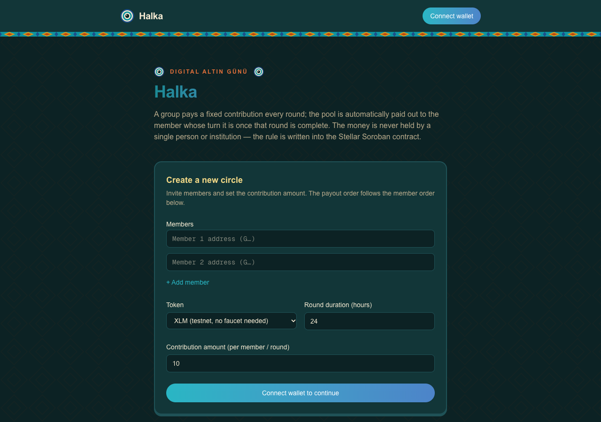
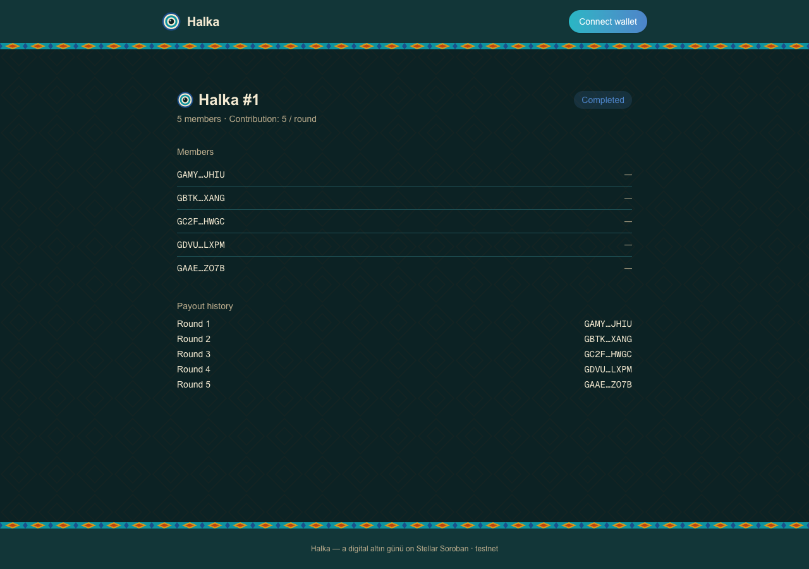
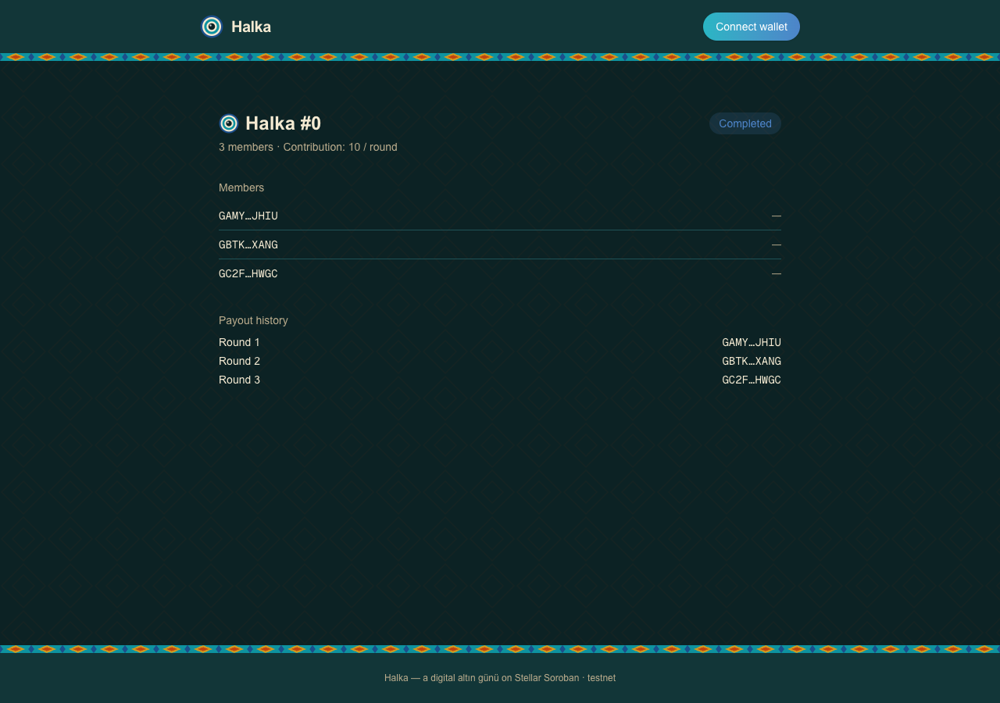
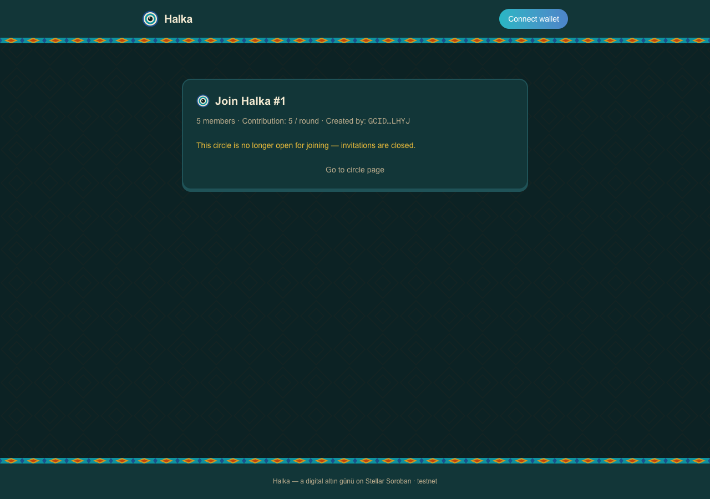
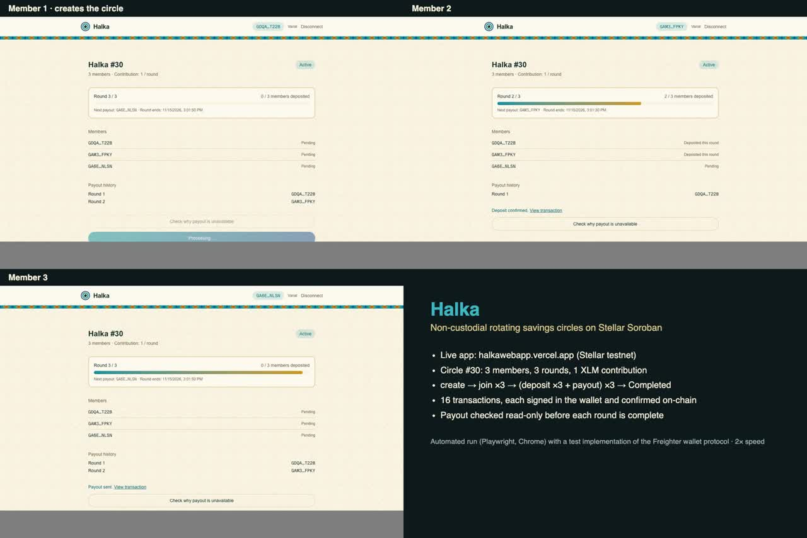

# Halka

[](https://github.com/fivauygn/halka/actions/workflows/ci.yml)
[](LICENSE)


**Non-custodial rotating savings circles on Stellar Soroban.**

Halka brings the *altın günü*, Türkiye's traditional rotating savings circle (ROSCA), on-chain. A
fixed group contributes the same amount every round, and once everyone has paid in, the whole
pool goes to the member whose turn it is. The rules live in a Soroban smart contract, so no
organizer or platform ever holds the group's money.

**Live app:** [halkawebapp.vercel.app](https://halkawebapp.vercel.app) · **Testnet contract:**
[`CBOGI62M…37HUI5Q`](https://stellar.expert/explorer/testnet/contract/CBOGI62MN5V3M7QSOKS7E6YWLLAO73LJIS3TMBMEFIADG2LDC37HUI5Q)



<details>
<summary>More screenshots</summary>

| Completed 5-member circle | Completed 3-member circle | Invite link, circle closed |
| --- | --- | --- |
|  |  |  |

</details>

### Demo

A full circle on the live app: three members join, deposit and receive payouts over three rounds.
The run is automated with Playwright; each member connects through Stellar Wallets Kit's Freighter
option, backed by a test implementation of the Freighter wallet protocol, and all 16 transactions
are confirmed on testnet ([run details](docs/testnet/browser-e2e-run.md)).

[](docs/media/halka-demo.mp4)

## Features

- **Non-custodial pool:** contributions are held by the contract and paid out only by its rules.
- **Fixed membership and payout order:** set at creation; every member confirms by joining.
- **Permissionless payout:** anyone can trigger a payout once a round is fully funded.
- **Timeout reclaim:** if a round stalls, each member can withdraw their own contribution.
- **Any Stellar asset:** works with any Stellar Asset Contract (verified with XLM and USDC).
- **Multi-wallet web app:** Freighter, Albedo and Hana via Stellar Wallets Kit.
- **Transaction preflight:** the app checks circle state and simulates every call before asking
  the wallet to sign, so contract errors are explained in plain language instead of failing on-chain.

## How it works

```
create_circle ──► join_circle × N ──► Active
                                        │
                     ┌──────────────────┘
                     ▼
              deposit × N ──► payout ──► next round ──► … ──► Completed
                     │
                     └── round timed out ──► reclaim (each member, own funds)
```

See [docs/architecture.md](docs/architecture.md) for the data model, the contract API and design
decisions.

## Repository structure

```
.
├── contracts/circle/   # Soroban smart contract (Rust) and unit tests
├── web/                # Next.js web app (TypeScript, Tailwind, Stellar Wallets Kit)
├── docs/               # Architecture, wallet integration and testnet verification logs
└── .github/workflows/  # CI: contract tests and build, web lint, typecheck and build
```

## Getting started

### Prerequisites

- [Rust](https://rustup.rs) (stable) with the `wasm32v1-none` target
- [Stellar CLI](https://developers.stellar.org/docs/tools/cli) v27 or later
- [Node.js](https://nodejs.org) 24 or later

### Smart contract

```bash
rustup target add wasm32v1-none
cargo test --workspace      # run the unit tests
stellar contract build      # build the Wasm binary
```

### Web app

```bash
cd web
npm install
npm run dev                 # http://localhost:3000
```

The app connects to the deployed testnet contract by default. Configuration (RPC URL and token
contracts) lives in [`web/src/lib/config.ts`](web/src/lib/config.ts). See
[web/README.md](web/README.md) for details.

## Testing

| Layer | How | Where |
| --- | --- | --- |
| Contract unit tests | `cargo test --workspace` (21 tests) | [`contracts/circle/src/test.rs`](contracts/circle/src/test.rs) |
| Web unit and component tests | `npm test` (Vitest, Testing Library) | [`web/src/**/*.test.ts(x)`](web/src/) |
| Browser tests | `npm run test:e2e` (Playwright, Chrome) | [`web/e2e/`](web/e2e/) |
| Wallet-signed lifecycle on testnet | `npm run test:e2e` with three funded test accounts | [docs/testnet/browser-e2e-run.md](docs/testnet/browser-e2e-run.md) |
| Contract regression on testnet | `npm run test:contract` | [docs/wallet-integration.md](docs/wallet-integration.md#testnet-regression-harness) |

[CI](https://github.com/fivauygn/halka/actions/workflows/ci.yml) runs the contract tests and build,
web lint, type checks, unit and component tests, the production build, and the read-only browser
tests on every push. The [Testnet workflow](https://github.com/fivauygn/halka/actions/workflows/testnet.yml)
runs the regression harness and the wallet-signed browser lifecycle weekly, with fresh
Friendbot-funded accounts, so network upgrades that break the app are caught early. See
[CONTRIBUTING.md](CONTRIBUTING.md) for running these suites locally.

## Documentation

| Document | Contents |
| --- | --- |
| [Architecture](docs/architecture.md) | Data model, contract API, design decisions, known limitations |
| [Wallet integration](docs/wallet-integration.md) | Wallet compatibility matrix, transaction preflight, error messages, security boundary, test suites |
| [Acceptance report](docs/acceptance-report.md) | Per-wallet results for connection, signing, confirmation and state refresh |
| [Manual testing guide](docs/manual-testing.md) | Checking Freighter, Albedo and Hana by hand |
| [Testnet runs](docs/testnet/) | Transaction logs for every verification run |

## Testnet verification

Every run below executed on Stellar testnet against the deployed contract, and every transaction
can be checked on stellar.expert.

| Run | Token | Transactions |
| --- | --- | --- |
| [Deployment and first round](docs/testnet/first-round-xlm.md) | XLM | 10 |
| [5 members, 5 rounds](docs/testnet/five-member-cycle-xlm.md) | XLM | 36 |
| [3 members, 3 rounds](docs/testnet/three-member-cycle-usdc.md) | USDC | 16 |
| [Regression run: 19 scenarios](docs/testnet/regression-run.jsonl) | XLM | 14 submitted, 5 expected rejections |
| [Browser run on the live app: 3 members, 3 rounds, wallet-signed](docs/testnet/browser-e2e-run.md) | XLM | 16 |

Test accounts: [docs/testnet/accounts.md](docs/testnet/accounts.md).

## Security

Halka is a testnet prototype and **has not been audited**. Do not use it with real funds. The web
app never generates, stores or transmits private keys; all signing happens in the user's wallet.
Please report vulnerabilities privately as described in [SECURITY.md](SECURITY.md).

## Contributing

Contributions are welcome. See [CONTRIBUTING.md](CONTRIBUTING.md) for setup, tests and the pull
request process.

## Roadmap

- [x] Browser end-to-end test with wallet-signed testnet transactions
- [ ] Manual acceptance with the Freighter, Albedo and Hana wallets ([report](docs/acceptance-report.md))
- [ ] Fair payout order using verifiable randomness
- [ ] Late-payment and default handling beyond timeout reclaim
- [ ] Yield on idle pool balances
- [ ] Security audit before any mainnet deployment

## License

[MIT](LICENSE)
