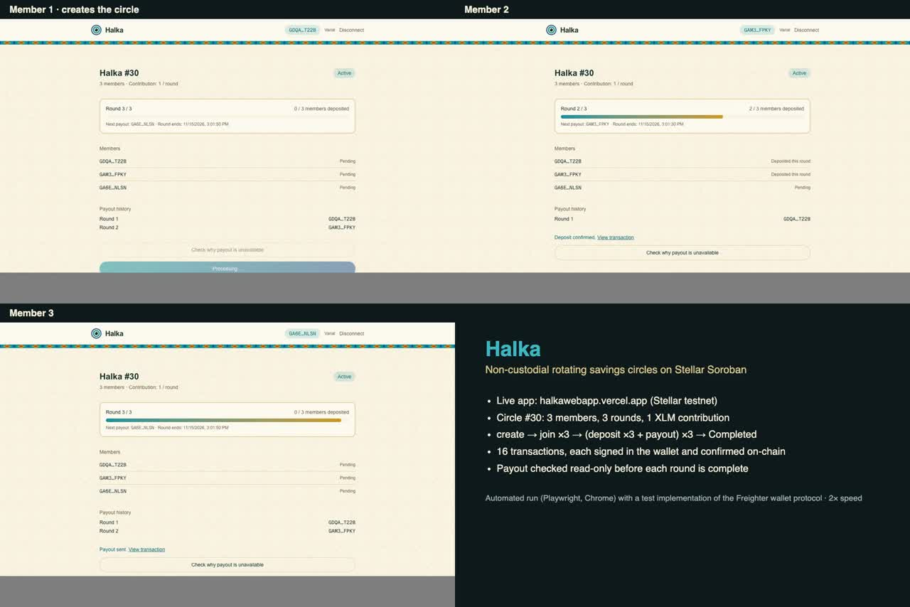

# Browser end-to-end run: 3 members, 3 rounds (testnet, XLM)

A full circle lifecycle driven through the **production deployment**
([halkawebapp.vercel.app](https://halkawebapp.vercel.app)) in Chrome by the Playwright test
[`web/e2e/circle-lifecycle.spec.ts`](../../web/e2e/circle-lifecycle.spec.ts). Each member uses its own browser
context and connects through Stellar Wallets Kit's Freighter option. The wallet is a test
implementation of the Freighter extension's page protocol
([`web/e2e/fake-freighter.ts`](../../web/e2e/fake-freighter.ts)), so the app runs its unmodified
wallet code path; keys stay in the test process. Every transaction is built by the app, checked by
its preflight, signed by that wallet and submitted to Stellar testnet. All 16 transactions
succeeded.

*[Watch the recording](../media/halka-demo.mp4) (66 s, 2× speed).*

- **Contract ID:** `CBOGI62MN5V3M7QSOKS7E6YWLLAO73LJIS3TMBMEFIADG2LDC37HUI5Q`
- **Circle ID:** `30`
- **Run date:** 2026-11-15
- **App:** production, https://halkawebapp.vercel.app
- **Token:** native XLM SAC · **Contribution:** 1 XLM / member / round · **Round duration:** 1 hour
- **Result:** `Completed`, payouts to member1, member2, member3 in order
- **Raw log:** [browser-e2e-run.jsonl](browser-e2e-run.jsonl)

## Members

| Member | Public key |
| --- | --- |
| member1 | `GDQAHCQIKXH6OBXO4Q2DOWCPWQRYDMDX2GZINBLP7QGH754ZPM7GT22B` |
| member2 | `GAM3R5SJDQWP4TZWARY5YHD653D2RUJ7EGZZDTBRILGYD6H4L5LFFPKY` |
| member3 | `GA6EF7FU2DEI6AFMTGY7CEKVUBLITE7HNV3MWGVBNYP7GWG4SPD2NLSN` |

## Transactions

| # | Action | Signed by | Tx |
| --- | --- | --- | --- |
| 1 | create_circle | member1 | [8631c884…83b3e367](https://stellar.expert/explorer/testnet/tx/8631c884e2454a3a3e5502ec1aed937c5d601dccbce9d46e4c83ddc283b3e367) |
| 2 | join_circle | member1 | [2f56214c…7e5c2b56](https://stellar.expert/explorer/testnet/tx/2f56214c99346cf47338c28423f00abbbbc44d0537686a9644b18af17e5c2b56) |
| 3 | join_circle | member2 | [1eb965ea…8aea2098](https://stellar.expert/explorer/testnet/tx/1eb965ea8d05a905911b83226b0a5014cd071b0598c09964661400fd8aea2098) |
| 4 | join_circle | member3 | [e57fa62a…3ae2a716](https://stellar.expert/explorer/testnet/tx/e57fa62a5367a6d90c2f0eefd6f2916ac39a9f5a95663009c1e4d9be3ae2a716) |
| 5 | deposit (round1) | member1 | [afadee85…daab4a30](https://stellar.expert/explorer/testnet/tx/afadee85093548a506f41bff9c1c19cf3da7309b4b650cb48d230bb8daab4a30) |
| 6 | deposit (round1) | member2 | [cee07932…9d697497](https://stellar.expert/explorer/testnet/tx/cee07932ab5f22ab6e2d54479e10539dc33f7a71f747fff99f4f68829d697497) |
| 7 | deposit (round1) | member3 | [9549a0ad…24896c7f](https://stellar.expert/explorer/testnet/tx/9549a0add272b60df6c82d4a78d4fdb8c1014f09aec10b669c37710f24896c7f) |
| 8 | payout (round1) | member3 | [a44ae022…5716b256](https://stellar.expert/explorer/testnet/tx/a44ae02230c1fe85e71bb98be87429af8be0b907b7c018bd84fe27575716b256) |
| 9 | deposit (round2) | member1 | [964a641b…6b843e71](https://stellar.expert/explorer/testnet/tx/964a641bcf37baa34d6617d478d73b577a0d840de101d4c8300d68826b843e71) |
| 10 | deposit (round2) | member2 | [fade7a28…6b372656](https://stellar.expert/explorer/testnet/tx/fade7a28f40ea5f49e1f6c0b6a3f8975dc08ce4dd4f4fbbaaccdffe86b372656) |
| 11 | deposit (round2) | member3 | [b0e30ace…26cfbfb9](https://stellar.expert/explorer/testnet/tx/b0e30ace08a9a76795bd05f935cd3d616b2943b11c829fef6680c19b26cfbfb9) |
| 12 | payout (round2) | member3 | [61cd9109…44d0dd70](https://stellar.expert/explorer/testnet/tx/61cd9109331c89e0d46dd31d78e19aba76774f3b47b45fc6f01021f544d0dd70) |
| 13 | deposit (round3) | member1 | [ca97edaf…aab6e14e](https://stellar.expert/explorer/testnet/tx/ca97edaf2be2efc49fb44e3d3edbd3ad56edcfa9de3fb25e7fdbcfb1aab6e14e) |
| 14 | deposit (round3) | member2 | [c74015e1…f8ddd810](https://stellar.expert/explorer/testnet/tx/c74015e139458d9b8e5e59ead070041ea472fcec77a7f9069201a5def8ddd810) |
| 15 | deposit (round3) | member3 | [a711aa23…0bcb8c84](https://stellar.expert/explorer/testnet/tx/a711aa235aaf17f5d79ed2adab362f139b67935e976464dd8096bf540bcb8c84) |
| 16 | payout (round3) | member3 | [234430e9…8b424175](https://stellar.expert/explorer/testnet/tx/234430e934cf687c846aac21a3632ff5c716f9e9c97cf028c80a227a8b424175) |

During each round, member2 also used the read-only **Check why payout is unavailable** action
before the round was complete; it showed the contract's `RoundNotComplete` message without
requesting a signature.
